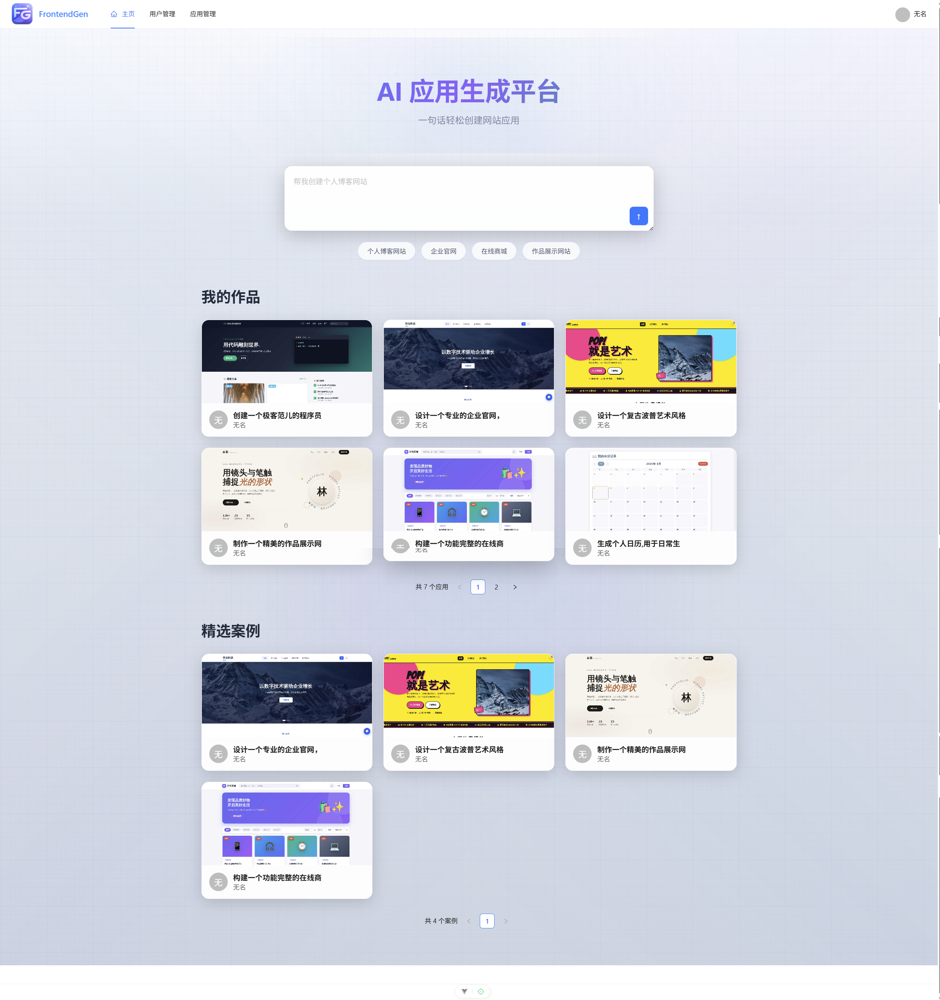
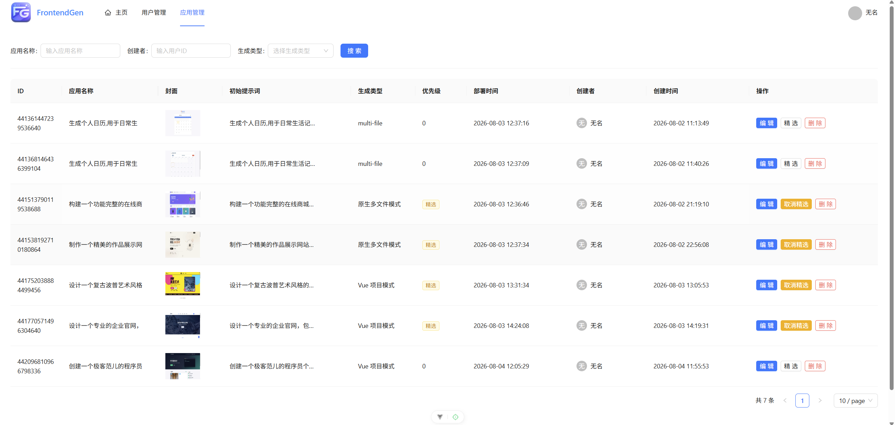
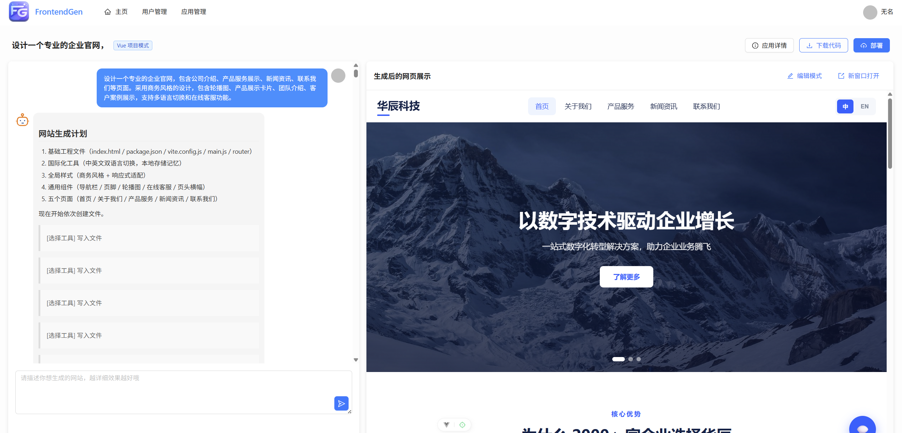
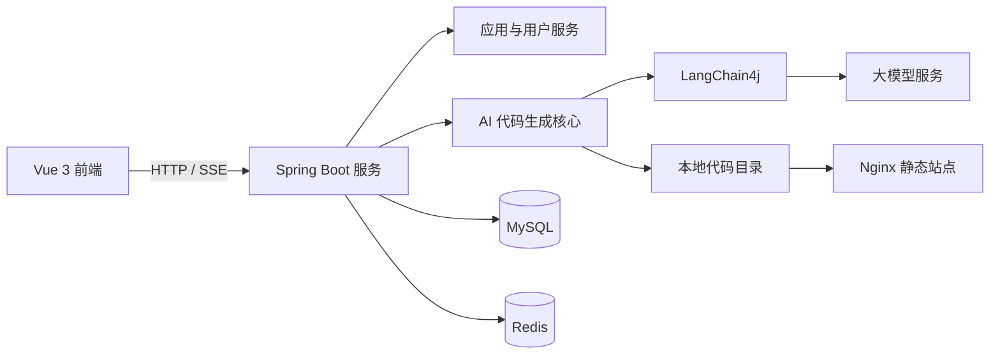

# FrontendGen

FrontendGen 是一个基于 Spring Boot、LangChain4j 和 Vue 3 开发的 AI 前端代码生成平台。用户只需描述网站需求，系统即可自动生成代码，并提供在线预览、持续对话修改、代码下载和部署能力。

## 项目介绍

FrontendGen 将大模型能力与前端工程化流程结合，支持从需求分析到网站部署的完整链路。

核心特点：

- 自然语言生成网站，降低前端开发门槛
- 支持单文件 HTML、多文件项目和 Vue 工程三种生成模式
- 基于 SSE 流式返回生成过程和结果
- 支持多轮对话修改、历史记录和代码持久化
- 支持网站预览、源码下载、构建和部署
- 支持图片搜索、页面截图和封面生成

## 项目预览

### 首页



### 应用管理



### 代码生成与预览



## 功能特性

### AI 代码生成

- 根据用户需求自动选择代码生成模式
- 流式生成 HTML、CSS、JavaScript 和 Vue 项目代码
- 支持工具调用和多文件工程生成
- 支持生成结果解析、保存和质量检查

### 应用管理

- 创建、修改、删除和查询应用
- 查看个人应用和精选应用
- 基于历史对话继续修改已生成网站
- 下载应用源码并部署为静态站点

### 用户管理

- 用户注册、登录和退出
- 基于 Redis 的 Session 会话管理
- 普通用户与管理员权限控制

## 技术架构



### 核心技术栈

- 后端框架：Java 21、Spring Boot 3.5、Spring MVC
- AI 框架：LangChain4j、LangGraph4j、Reactor
- 数据访问：MyBatis-Flex、MySQL 8
- 缓存与会话：Redis、Spring Session
- 前端框架：Vue 3、TypeScript、Vite、Pinia
- UI 组件：Ant Design Vue
- 工程工具：Maven、npm、Docker Compose、Nginx
- 外部服务：OpenAI 兼容模型、Pexels、腾讯云 COS、DashScope

### 主要模块

- `controller`：用户、应用、生成和文件接口
- `service`：业务逻辑与应用管理
- `ai`：大模型服务、路由和提示词
- `core`：代码解析、保存、构建和流式处理
- `generator`：HTML、多文件和 Vue 项目生成器
- `langgraph4j`：基于工作流的实验性生成模块
- `codegen-frontend`：Vue 3 前端项目

## 安装部署

### 环境要求

- JDK 21+
- Maven 3.9+
- Node.js 22+
- MySQL 8.0+
- Redis 6.0+
- Chrome 或 Chromium，用于网站截图
- Docker 和 Docker Compose，可选

### 1. 启动基础服务

项目提供了 MySQL、Redis 和 Nginx 的 Docker Compose 配置：

```bash
docker compose up -d mysql redis-master
```

也可以使用本地已经安装的 MySQL 和 Redis。

### 2. 初始化数据库

创建数据库后，执行初始化脚本：

```bash
mysql -u root -p 数据库名 < src/main/resources/db/create_table.sql
```

脚本会创建用户表、应用表和对话历史表。

### 3. 修改后端配置

在 `src/main/resources/application-dev.yaml` 中配置以下内容：

- MySQL 连接地址、用户名和密码
- Redis 地址、端口和密码
- OpenAI 兼容接口的地址、API Key 和模型名称
- Pexels API Key
- 腾讯云 COS 的 SecretId、SecretKey、地域和存储桶
- DashScope API Key，可选

`application-dev.yaml` 已被 Git 忽略，请勿将真实密钥提交到仓库。

### 4. 启动后端

```bash
mvn spring-boot:run
```

后端默认地址：`http://localhost:8123/api`

### 5. 启动前端

```bash
cd codegen-frontend
npm install
npm run dev
```

前端默认地址：`http://localhost:5173`

## 构建部署

### 后端构建

```bash
mvn clean package -DskipTests
```

生产环境通过 `prod` Profile 配置 MySQL 和 Redis，并使用外部环境变量保存敏感信息。

### 前端构建

```bash
cd codegen-frontend
npm install
npm run build
```

构建结果位于 `codegen-frontend/dist`，可部署到 Nginx 或其他静态资源服务器。

### 生成站点部署

启动 Compose 中的 Nginx：

```bash
docker compose up -d nginx
```

Nginx 会挂载 `tmp/code_deploy`，用于访问系统发布的静态网站。当前 Docker Compose 只负责 MySQL、Redis 和生成站点 Nginx，后端与管理前端需要单独运行或部署。

## 接口文档

启动后端后访问：

```text
http://localhost:8123/api/doc.html
```

OpenAPI 地址：

```text
http://localhost:8123/api/v3/api-docs
```

## 项目结构

```text
FrontendGen
├── src/main/java/com/renix/codegen   后端源码
├── src/main/resources                配置、SQL、Mapper 和提示词
├── codegen-frontend                  Vue 3 前端
├── data                              Docker 服务数据和 Nginx 配置
├── tmp/code_output                   AI 生成的源码
├── tmp/code_deploy                   已部署的静态网站
├── docker-compose.yaml               基础服务编排
└── pom.xml                           Maven 配置
```

## 注意事项
- Vue 项目生成需要运行环境已安装 Node.js 和 npm。
- 页面截图需要服务器安装 Chrome 或 Chromium。
- 生产环境应修改默认密码、部署域名和跨域配置，并通过环境变量管理密钥。
